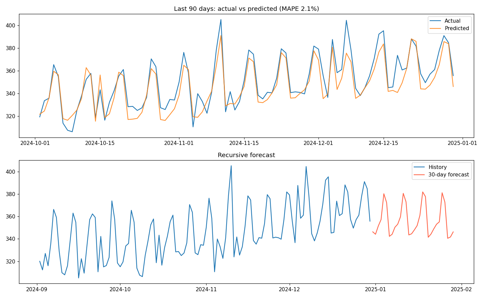

# Sales Forecasting

Forecast daily sales with lag features, rolling averages and Gradient Boosting.



## How it works

1. Generates three years of daily sales with trend, weekly and yearly seasonality, and promotions.
2. Builds calendar, lag (1/7/14/28 days) and rolling-mean features.
3. Models the deviation from the recent 28-day level, because tree models cannot extrapolate a rising trend.
4. Evaluates on the last 90 days against a seasonal-naive baseline, then produces a 30-day recursive forecast.

## Results

| Method | MAE |
|---|---|
| Seasonal-naive baseline | 9.45 |
| Gradient Boosting | 7.45 (MAPE 2.1%) |

That is 21% better than the baseline. *Synthetic data.*

## Quick start

```bash
git clone https://github.com/<your-username>/sales-forecasting-ml.git
cd sales-forecasting-ml
python -m venv .venv && source .venv/bin/activate   # Windows: .venv\Scripts\activate
pip install -r requirements.txt
python sales_forecasting.py
```

The script prints its metrics and saves `results.png` in the same folder. No dataset download is needed.

## Use your own data

Load a CSV with columns `date, sales, promo` (promo is 0 or 1) in `main()`.

## License

MIT. See [LICENSE](LICENSE).
